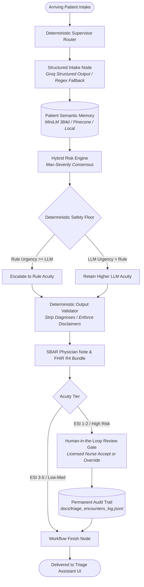

# Agentic Triage Copilot: Hybrid Triage Assistant Prototype

[](https://github.com/adarshpradeep/agentic-triage-system/actions)
[](https://www.python.org/)
[](https://github.com/langchain-ai/langgraph)
[-7928ca.svg)](https://huggingface.co/sentence-transformers/all-MiniLM-L6-v2)
[](https://hl7.org/fhir/R4/)
[](https://streamlit.io/)
[](LICENSE)

> **A prototype hybrid multi-agent triage assistant for emergency department intake combining LLM structured reasoning with an inviolable deterministic safety floor, real sentence embeddings, and human-in-the-loop auditability.**

---

## 30-Second Interview Pitch

> *"Triage nurses lose precious minutes on manual intake and face immense cognitive load under crowded emergency department conditions. I designed and built an agentic triage decision-support copilot in LangGraph. It converts free-text intake into clinical concepts, screens vital signs against ESI v4 danger zones, and combines LLM semantic reasoning with an un-breachable deterministic safety floor: the system may escalate acuity based on context, but can never de-escalate risk below what red-flag rules mandate. Every recommendation requires licensed nurse sign-off, and overrides are permanently audited."*

---

## Table of Contents

- [The Problem: Why Emergency Triage Needs Decision Support](#the-problem-why-emergency-triage-needs-decision-support)
- [System Architecture & Workflow](#system-architecture--workflow)
- [Key Design Decisions](#key-design-decisions)
- [Empirical Evaluation Results](#empirical-evaluation-results)
- [Quickstart & Execution Modes](#quickstart--execution-modes)
- [Repository Structure](#repository-structure)
- [Clinical Safety, Limitations & Ethics](#clinical-safety-limitations--ethics)
- [Future Work](#future-work)
- [License & Medical Disclaimer](#license--medical-disclaimer)

---

## The Problem: Why Emergency Triage Needs Decision Support

Emergency department (ED) triage is a high-stakes, time-compressed clinical gateway. Triage staff must categorize arriving patients into the 5-level **Emergency Severity Index (ESI)** within 2 to 5 minutes based on brief verbal accounts and objective vital signs.

1. **Cognitive Fatigue & High Variance:** Published clinical studies (*Tanabe et al., Dong et al.*) show human triage nurses agree on exact ESI levels only **55% to 65%** of the time.
2. **The Danger of Under-Triage:** Under-triaging a patient (classifying a true life threat as urgent or routine) leads to catastrophic diagnostic and treatment delays (e.g. delayed ECG for acute STEMI or delayed antibiotics for sepsis).
3. **Why Pure LLMs are Unsafe for Triage:** Autonomous generative models are prone to hallucination, subtle prompt-injection drift, and dangerous de-escalation of urgent presentations when patients downplay symptoms.

**The Solution:** A **hybrid human-in-the-loop architecture** where an LLM assists with language extraction and holistic reasoning, but is strictly bounded by a deterministic rule-based safety floor and supervised by a licensed triage clinician.

---

## System Architecture & Workflow


The copilot operates as a deterministic **LangGraph StateGraph** where each specialized node encapsulates a single clinical responsibility:



### Graph Execution Nodes

| Node | Implementation | Function |
|:---|:---|:---|
| **`supervisor`** | Deterministic Router | Evaluates graph state, validates prerequisites, and determines the next step. Zero LLM nondeterminism in routing. |
| **`intake`** | `agent/nodes/intake.py` | Extracts standardized symptoms, duration, severity, pertinent negatives, and red flags using Pydantic structured output with regex fallback. |
| **`risk`** | `agent/nodes/risk.py` | Combines physiological vital signs, comorbidity context, and patient memory to compute clinical acuity. |
| **`safety`** | `agent/nodes/safety.py` | Validates generated text against blacklisted diagnostic claims, ensures mandatory disclaimers, and sanitizes output. |
| **`sbar`** | `agent/sbar_generator.py` | Formulates an ED physician SBAR handoff note and compiles an interoperable HL7 FHIR R4 Transaction Bundle. |
| **`human_review`** | `agent/multi_agent.py` | Suspends execution on high-acuity recommendations, requiring licensed nurse sign-off or recorded override. |
| **`finish`** | `agent/multi_agent.py` | Finalizes state, persists semantic encounter memory, and delivers payload to UI. |

---

## Key Design Decisions

### 1. Hybrid LLM + Rules Safety Floor Invariant
The central safety design principle of the system is the **inviolable safety floor**:

$$\text{Final Urgency} = \max(\text{Urgency}_{\text{Rules}}, \, \text{Urgency}_{\text{LLM}})$$

- **How it works:** Deterministic regex pattern matching (with windowed NegEx negation handling) and pediatric age-adjusted physiological vital sign thresholds establish a strict lower bound on severity.
- **Why it matters:** If an LLM hallucinates `routine` for a patient describing "crushing chest tightness" or displaying $\text{SpO}_2 \le 90\%$, the deterministic safety floor unconditionally overrides the model, forces an `emergency` classification, and logs a disagreement flag.

### 2. Why a Deterministic Supervisor?
Clinical workflows in triage are protocolized standards of care, not exploratory creative chats. Entrusting workflow routing to an LLM introduces latency, cost, and routing hallucinations. By using a deterministic graph router, execution flow is $100\%$ predictable and formally testable.

### 3. Human-in-the-Loop (HITL) Gate with Mandatory Override Auditing
AI never makes autonomous clinical decisions. High-acuity recommendations require licensed nurse confirmation. When overriding the copilot, the clinician must select a mandatory clinical rationale code (e.g. *Bedside ECG finding*, *Atypical presentation*, *Vital signs normalized post-treatment*). Overrides are permanently recorded to `docs/triage_encounters_log.jsonl` for quality assurance.

### 4. Real Semantic Memory (384-dimensional Embeddings)
Patient encounter memory utilizes `sentence-transformers/all-MiniLM-L6-v2` generating 384-dimensional L2-normalized vector embeddings.
- Storage: Managed `Pinecone` index (serverless) or zero-dependency in-process `LocalMemory` using NumPy cosine similarity.
- Clinical Impact: Cross-encounter memory injects prior relevant history (e.g. prior coronary artery disease or recurrent anaphylaxis) into the risk node to alert clinicians to insidious symptom patterns.

---

## Empirical Evaluation Results

The system was evaluated against the standardized **150-case clinical benchmark** (`eval/cases.jsonl`) spanning cardiac, respiratory, neurological, trauma, infectious, and psychiatric scenarios.

To uphold strict machine learning hygiene, the dataset is partitioned into:
- **Development Split ($n=90$):** Used for rule refinement and prompt design.
- **Held-Out Test Split ($n=60$):** Evaluated strictly once to measure true generalization.

### Performance on Frozen Held-Out Test Set ($n=60$)
*Directly reproduced from `eval/results/summary.md` generated by `eval/run_eval.py`:*

| Evaluation Metric | Rules-Only (Safety Floor) | Hybrid Consensus (LLM + Rules) |
|:---|:---:|:---:|
| **Sample Size ($n$)** | **60** | *Requires API Key* |
| **Overall Accuracy** | **66.67%** | — |
| **Macro-F1 Score** | **61.31%** | — |
| **Emergency Recall (Sensitivity)** | **62.50%** | — |
| **Emergency Precision** | **100.0%** | — |
| **Urgent Recall** | **33.33%** | — |
| **Routine Recall** | **87.50%** | — |
| **Under-Triage Rate (Type II Error)** | **28.33%** | — |
| **Over-Triage Rate (Type I Error)** | **5.00%** | — |
| **P50 Latency** | **0.19 ms** | — |
| **P95 Latency** | **2.57 ms** | — |

> [!NOTE]
> **Dataset Caveats & Methodology:**
> The evaluation dataset (`eval/cases.jsonl`) comprises synthetic, author-labeled vignettes created for engineering validation. While modeled after ESI v4 criteria, they are **not clinically validated on real hospital patient records**. In interviews and papers, we disclose that evaluating LLMs on synthetic benchmarks carries risk of circularity. For a full autopsy of misclassified test cases, see [`docs/error_analysis.md`](docs/error_analysis.md).

---

## Quickstart & Execution Modes

The repository is built to run **$100\%$ offline with zero API keys required**, while seamlessly scaling to hybrid cloud inference when credentials are provided.

### 1. Installation

```bash
git clone https://github.com/adarshpradeep/agentic-triage-system.git
cd agentic-triage-system

# Create and activate virtual environment
python -m venv venv
.\venv\Scripts\Activate.ps1   # Windows
# source venv/bin/activate    # Linux / macOS

# Install production and development dependencies
pip install -r requirements.txt -r requirements-dev.txt
# Or using the Makefile:
make install
```

### 2. Run Automated Test Suite (Offline)

```bash
make test
# Or directly:
pytest tests/ -v
```

### 3. Run Benchmark Evaluation

```bash
# Evaluate rules safety floor on held-out test split
make eval
# Or directly:
python -m eval.run_eval --mode rules --split test
```

### 4. Launch Streamlit Triage Assistant Prototype

```bash
make run
# Or directly:
streamlit run app.py
```
Open browser at `http://localhost:8501`.

### 5. Configuring Full Hybrid Mode (Optional)

Copy `.env.example` to `.env`:
```bash
cp .env.example .env
```

| Variable | Required? | Purpose |
|:---|:---:|:---|
| `GROQ_API_KEY` | Optional | Groq Cloud fast LLM tool-calling (`openai/gpt-oss-120b` or `llama-3.3-70b-versatile`) |
| `PINECONE_API_KEY` | Optional | Managed vector database for semantic patient memory (dimension = 384) |
| `PINECONE_INDEX_NAME` | Optional | Pinecone index name (`healthcare-triage`) |
| `INFERMEDICA_APP_ID` | Optional | Infermedica Clinical Knowledge Base v3 API ID |
| `INFERMEDICA_APP_KEY` | Optional | Infermedica Clinical Knowledge Base v3 Secret Key |

*When keys are omitted, the application automatically defaults to `LocalMemory` and the `Offline Rules-Only` safety floor.*

---

## Repository Structure

```
agentic-triage-system/
├── agent/                         # Core Multi-Agent Triage Package
│   ├── memory/                    # Vector memory & embeddings subsystem
│   │   ├── embeddings.py          # sentence-transformers (all-MiniLM-L6-v2, 384-dim)
│   │   └── store.py               # PatientMemory protocol, LocalMemory & PineconeMemory
│   ├── nodes/                     # LangGraph modular nodes
│   │   ├── intake.py              # Hybrid symptom extraction (Groq structured / regex)
│   │   ├── risk.py                # Hybrid risk assessment & safety floor invariant
│   │   └── safety.py              # Deterministic output validator & disclaimer guard
│   ├── audit_logger.py            # Thread-safe JSONL encounter audit logger & analytics
│   ├── infermedica_client.py      # Infermedica v3 API client (parse, diagnosis, triage)
│   ├── llm.py                     # ChatGroq client factory & fallback management
│   ├── multi_agent.py             # LangGraph StateGraph pipeline & fast-path logic
│   ├── rules.py                   # Deterministic red-flag safety floor & NegEx engine
│   ├── sbar_generator.py          # Physician SBAR note & HL7 FHIR R4 Bundle exporter
│   └── schemas.py                 # Pydantic schemas (IntakeResult, RiskResult, RiskLevel)
├── assets/                        # Architecture diagrams and UI assets
│   └── architecture_diagram.png   # Full system architectural topology diagram
├── docs/                          # Engineering reports, architecture & safety guides
│   ├── architecture.md            # Detailed architecture specification & flow sequences
│   ├── error_analysis.md          # Comprehensive autopsy of under-triage and over-triage
│   ├── safety.md                  # Safety notes, ethics, and governance limitations
│   └── audit.md                   # Legacy codebase audit and dependency isolation notes
├── eval/                          # Quantitative evaluation harness
│   ├── cases.jsonl                # 150 standardized vignettes (dev/test splits)
│   ├── README.md                  # Dataset methodology, provenance & caveat documentation
│   ├── run_eval.py                # Multi-mode evaluation CLI runner
│   └── results/                   # Evaluation artifacts (metrics JSON, confusion matrices)
├── tests/                         # Pytest automated test suite
│   ├── test_graph_routing.py      # LangGraph routing and fast-path execution tests
│   ├── test_memory.py             # Vector embedding and retrieval unit tests
│   ├── test_multi_agent.py        # End-to-end multi-agent integration tests
│   ├── test_risk_hybrid.py        # Safety floor invariant verification tests
│   ├── test_rules.py              # Deterministic red-flag & negation unit tests
│   └── test_safety_validator.py   # Output sanitizer and diagnosis blocking tests
├── .github/workflows/ci.yml       # GitHub Actions CI matrix pipeline (Python 3.11, 3.12)
├── app.py                         # Streamlit Triage Assistant Prototype UI
├── Makefile                       # Developer shortcuts (install, test, lint, eval, run)
├── pyproject.toml                 # Ruff linter and pytest configurations
├── requirements.txt               # Production dependencies
├── requirements-dev.txt           # Testing and development tooling
├── CONTRIBUTING.md                # Contribution guidelines and coding standards
├── CHANGELOG.md                   # Version progression across engineering phases
└── README.md                      # System documentation and interview guide
```

---

## Clinical Safety, Limitations & Ethics

For complete documentation, see [`docs/safety.md`](docs/safety.md).

1. **Non-Diagnostic Clearance:** This software is an **engineering research prototype and not a certified medical device (FDA SaMD / CE-IVD)**. It is prohibited from autonomous clinical deployment.
2. **Known Failure Modes:**
   - *Negation Drift:* Double negatives or conversational idioms may occasionally challenge regex parsing.
   - *Anchoring on Memory:* Historical comorbidities might bias an LLM toward chronic explanations unless balanced by unconditional vital sign checks.
   - *Code-Mixing & Dialects:* Non-standard English or colloquial descriptions require LLM semantic interpretation.
3. **Privacy & PHI Protection:** No real patient health information is contained in this repository. If productionized, would require de-identification, consent, encryption and audit logging (not implemented here).
4. **Metric Philosophy:** In medical triage, **Emergency Recall (Sensitivity on ESI 1–2) supersedes aggregate accuracy**. Missing a critically ill patient carries fatal consequences; over-triaging merely causes temporary clinical review.

---

## Future Work

- [ ] **Multi-Clinician Annotation:** Collect inter-annotator agreement (Fleiss' Kappa) across a panel of practicing emergency triage nurses on real anonymized triage notes.
- [ ] **On-Premise Clinical LLM Deployment:** Benchmark local medical open-weights (e.g. BioMistral-7B, Meditron) via vLLM to eliminate third-party API dependencies.
- [ ] **SMART-on-FHIR App Integration:** Package the prototype interface as an embedded EHR sidebar for Epic Systems and Cerner EHR.

---

## License & Medical Disclaimer

This project is licensed under the [MIT License](LICENSE).

**Medical Disclaimer:** This system is for educational and research evaluation only. It does not provide medical diagnoses or treatment recommendations. All triage assignments must be determined and finalized by licensed healthcare professionals.
