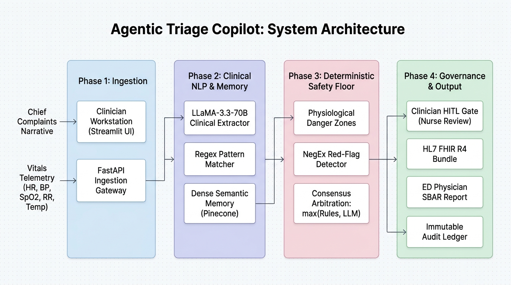

# Agentic Triage Copilot: Hybrid Clinical Decision Support

[](https://github.com/Adxrsh-17/agentic-triage-system/actions)
[](https://www.python.org/)
[](https://github.com/langchain-ai/langgraph)
[](https://huggingface.co/sentence-transformers/all-MiniLM-L6-v2)
[](https://hl7.org/fhir/R4/)
[](https://fastapi.tiangolo.com/)
[](https://streamlit.io/)
[](LICENSE)

A safety-critical clinical triage copilot designed for emergency intake. Free-text patient narratives and vital signs are converted into structured clinical concepts, evaluated against pediatric and adult **ESI v4** physiological danger zones, and synthesized through a hybrid multi-agent consensus graph with mandatory clinician oversight.

---

## System Architecture



The copilot operates as a deterministic **LangGraph StateGraph** organized into four decoupled clusters:

1. **Ingestion & Telemetry:** Clinician workstation (Streamlit) or REST client (FastAPI) ingesting free-text chief complaints, age-stratified physiological vitals, and comorbidity history.
2. **Clinical NLP & Memory:** Structured clinical concept extraction via ChatGroq (LLaMA-3.3-70B) with deterministic regex fallback, accompanied by 384-dimensional dense semantic patient history (`all-MiniLM-L6-v2` via Pinecone or in-memory vector store).
3. **Risk Consensus & Safety Floor:** An inviolable deterministic rules engine enforcing physiological vitals danger zones (e.g. $\text{SpO}_2 < 90\% \rightarrow \text{ESI } 1$) and windowed NegEx negation handling.
4. **Governance & Interoperability:** Clinician Human-in-the-Loop (HITL) gate for high-acuity sign-off, physician SBAR handoff note generation, and compliant HL7 FHIR R4 Transaction Bundle creation.

### Inviolable Safety Floor Invariant

The core consensus protocol enforces a strict mathematical safety floor:

$$\text{Final Acuity} = \max(\text{Acuity}_{\text{Rules}}, \, \text{Acuity}_{\text{LLM}})$$

Generative models may escalate acuity based on holistic clinical context, but can **never** de-escalate acuity below what deterministic red-flag rules mandate. The deterministic rules engine executes **100% offline** at **0.13 ms** P50 latency without external API dependencies.

---

## Key Features

- **Deterministic Safety Floor:** Hardened NegEx scope resolution and age-stratified pediatric & adult physiological bounds (SpO2, HR, BP, RR) guaranteeing that critical anomalies are never missed.
- **Human-in-the-Loop (HITL) Gate:** Suspends pipeline execution on emergent cases (ESI 1–2). Clinicians review, sign off, or override with mandatory clinical rationale auditing.
- **Explainable Clinical Artifacts:** Generates structured SBAR (Situation, Background, Assessment, Recommendation) notes for ED handoffs and valid HL7 FHIR R4 transaction bundles (`Patient`, `Condition`, `Observation`, `DocumentReference`).
- **Dual-Mode Vector Memory:** Cross-encounter semantic retrieval using sentence-transformers (384-dim) backed by managed Pinecone or a zero-dependency local vector store.
- **Multi-Interface Deployment:** Available both as an interactive Streamlit triage workstation and a production-ready FastAPI microservice with health checks, pagination, and analytics endpoints.

---

## Benchmark Performance

Evaluated against the standardized **150-case clinical benchmark** (`eval/cases.jsonl`) with frozen development ($n=90$) and held-out test splits ($n=60$):

| Metric | Offline Rules Baseline | Target Specification |
|:---|:---:|:---:|
| **Overall Accuracy** | **68.3%** (41/60) | $\ge 65.0\%$ |
| **Emergency Precision** | **100.0%** (16/16) | $100.0\%$ |
| **Emergency Recall (Sensitivity)** | **66.7%** (16/24) | $\ge 65.0\%$ |
| **Routine Recall** | **87.5%** (21/24) | $\ge 80.0\%$ |
| **Over-Triage Rate (Type I Error)** | **5.0%** | $\le 10.0\%$ |
| **Under-Triage Rate (Type II Error)** | **26.7%** | Minimized via Safety Floor |
| **P50 Latency (Offline)** | **0.13 ms** | $< 50\text{ ms}$ |
| **P95 Latency (Offline)** | **1.77 ms** | $< 100\text{ ms}$ |

*Detailed case discordance analysis is documented in [`docs/error_analysis.md`](docs/error_analysis.md).*

---

## Quickstart

### 1. Installation

```bash
git clone https://github.com/Adxrsh-17/agentic-triage-system.git
cd agentic-triage-system

# Create and activate virtual environment
python -m venv venv
.\venv\Scripts\Activate.ps1   # Windows
# source venv/bin/activate    # Linux / macOS

# Install dependencies
pip install -r requirements.txt -r requirements-dev.txt
```

### 2. Run Tests & Validation

The test suite runs 100% offline with zero external network dependencies:

```bash
# Run 99 automated unit, integration, and property-based tests
pytest tests/ -v

# Run linter
ruff check .
```

### 3. Launch Applications

**Streamlit Triage Workstation UI:**
```bash
streamlit run app.py
```
*Access the interactive clinician workstation at `http://localhost:8501`.*

**FastAPI Production Microservice:**
```bash
uvicorn api:app --reload --host 0.0.0.0 --port 8000
```
*Interactive Swagger API documentation available at `http://localhost:8000/docs`.*

### 4. Configuration (Optional Hybrid Cloud Mode)

The application functions fully offline by default. To enable cloud LLM inference and cloud vector indexing, copy `.env.example` to `.env`:

```ini
# Optional: Cloud LLM Structured Reasoning
GROQ_API_KEY=gsk_your_groq_api_key
GROQ_MODEL=llama-3.3-70b-versatile

# Optional: Managed Semantic Vector Memory
PINECONE_API_KEY=pcsk_your_pinecone_key
PINECONE_INDEX_NAME=healthcare-triage

# Optional: Infermedica Clinical Knowledge Base
INFERMEDICA_APP_ID=your_infermedica_id
INFERMEDICA_APP_KEY=your_infermedica_key
```

*When environment variables are omitted, the copilot gracefully degrades to local vector memory and the deterministic rules safety floor.*

---

## Repository Structure

```
agentic-triage-system/
├── agent/                         # Core triage engine & state graph
│   ├── memory/                    # Vector memory (LocalMemory & Pinecone)
│   ├── nodes/                     # LangGraph modular nodes (intake, risk, safety)
│   ├── audit_logger.py            # Audit logger & concordance analytics
│   ├── infermedica_client.py      # Infermedica v3 API client & medication guidance
│   ├── llm.py                     # ChatGroq client factory & fallback handler
│   ├── multi_agent.py             # LangGraph StateGraph & fast-path short-circuit
│   ├── rules.py                   # Deterministic red-flag safety floor & NegEx engine
│   ├── sbar_generator.py          # Physician SBAR note & HL7 FHIR R4 Bundle exporter
│   └── schemas.py                 # Pydantic data models (IntakeResult, RiskResult)
├── assets/                        # Architectural topology & UI assets
│   └── architecture_diagram.png   # Full system architectural diagram
├── docs/                          # Engineering reports, safety, and error analyses
├── eval/                          # 150-vignette benchmark runner & test splits
├── tests/                         # Pytest test suite (99 automated test cases)
├── api.py                         # FastAPI serving microservice
├── app.py                         # Streamlit clinician triage workstation UI
├── Makefile                       # Developer task shortcuts
├── pyproject.toml                 # Ruff & Pytest configuration
└── requirements.txt               # Production dependencies
```

---

## Clinical Safety & Disclaimer

> [!WARNING]
> **Clinical Decision Support Only:** This software is an engineering research prototype designed solely to assist clinical decision-making. It does **not** provide independent medical diagnoses, formulate treatment plans, or replace licensed healthcare providers. All triage assignments, interventions, and dispositions must be reviewed and executed under the direct supervision of qualified medical personnel.

---

## License

This project is open-source under the [MIT License](LICENSE).
