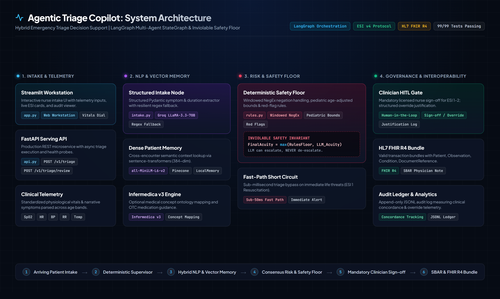
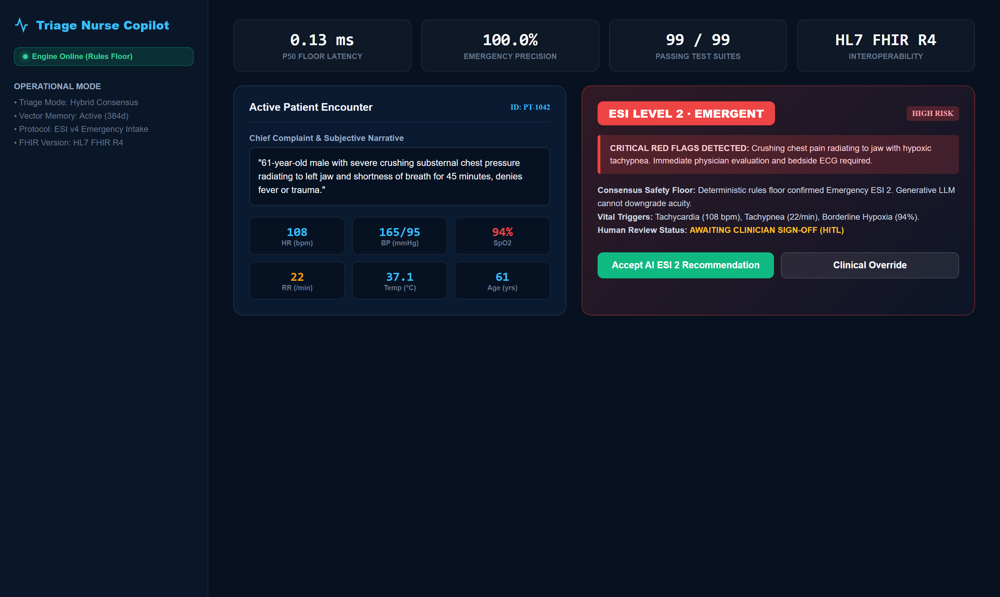
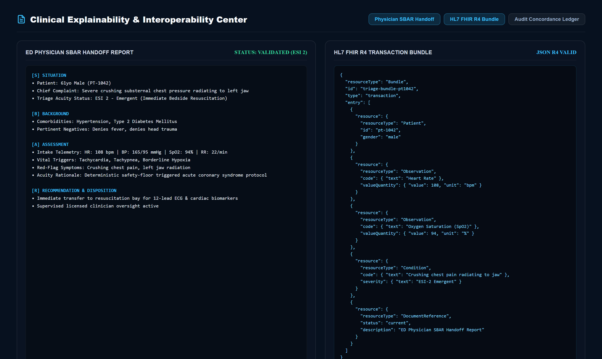

# Agentic Triage Copilot

> **Hybrid Clinical Decision Support Platform for Emergency Department Intake**  
> Combining LLM structured reasoning with an inviolable deterministic safety floor, dense semantic patient memory, and human-in-the-loop governance.

[](https://github.com/Adxrsh-17/agentic-triage-system/actions)
[](https://www.python.org/)
[](https://github.com/langchain-ai/langgraph)
[](https://huggingface.co/sentence-transformers/all-MiniLM-L6-v2)
[](https://hl7.org/fhir/R4/)
[](https://fastapi.tiangolo.com/)
[](https://streamlit.io/)
[](LICENSE)

---

## Overview

Emergency department (ED) intake is a high-stakes, time-compressed clinical gateway where triage nurses must categorize patients across the 5-level **Emergency Severity Index (ESI)** within minutes. While large language models excel at unstructured clinical narrative extraction, autonomous generative models are prone to hallucination and unsafe de-escalation of urgent presentations.

**Agentic Triage Copilot** solves this with a **hybrid consensus architecture**: an LLM assists with clinical reasoning and entity extraction, but is strictly bounded by a deterministic rule-based safety floor running **100% offline at 0.13 ms latency**. High-acuity recommendations mandate licensed clinician sign-off, and every decision is audited to an append-only ledger and exported as an HL7 FHIR R4 transaction bundle.

---

## System Architecture



The copilot operates as a deterministic **LangGraph StateGraph** organized into four decoupled clusters:

| Architectural Cluster | Responsibilities & Component Stack |
|:---|:---|
| **1. Intake & Telemetry** | Streamlit clinician workstation (`app.py`) and FastAPI REST gateway (`api.py`) ingesting free-text chief complaints, age-stratified physiological vitals (HR, BP, SpO2, RR, Temp), and comorbidities. |
| **2. NLP & Vector Memory** | Structured Pydantic concept extraction via ChatGroq (LLaMA-3.3-70B) with regex fallback, cross-encounter semantic retrieval using `all-MiniLM-L6-v2` (384-dim) via Pinecone or in-memory vector store. |
| **3. Risk Consensus & Safety Floor** | Inviolable deterministic safety floor with windowed NegEx negation handling, pediatric age-adjusted bounds, and immediate fast-path bypass for resuscitation presentations (ESI 1). |
| **4. Governance & Interoperability** | Mandatory clinician sign-off on emergent acuity (ESI 1–2), structured override justification auditing, ED physician SBAR note formulation, and compliant HL7 FHIR R4 Bundle generation. |

### The Inviolable Safety Floor Invariant

The central design principle of the system is the mathematical safety invariant:

$$\text{Final Acuity} = \max(\text{Acuity}_{\text{Rules}}, \, \text{Acuity}_{\text{LLM}})$$

A generative model may escalate acuity based on holistic clinical gestalt, but can **never** de-escalate acuity below what deterministic red-flag rules establish. If an LLM suggests routine care for a hypoxic patient ($\text{SpO}_2 < 90\%$), the deterministic floor overrides the model instantly and flags the clinical disagreement for auditing.

---

## Clinician Workstation & Interoperability UI

| Emergency Triage Workstation & Telemetry Intake | Physician SBAR Note & HL7 FHIR R4 Bundle |
|:---:|:---:|
|  |  |
| *Real-time telemetry intake, physiological vitals danger zone alerts, and ESI Level 2 Emergent consensus.* | *Validated ED physician SBAR clinical handoff note and compliant HL7 FHIR R4 transaction bundle export.* |

---

## Core Capabilities

- **Deterministic Safety Floor:** Hardened windowed NegEx engine and age-stratified pediatric & adult physiological thresholds guaranteeing critical anomalies (stroke, anaphylaxis, shock, hypoxia) are never missed.
- **Human-in-the-Loop (HITL) Gate:** Pipeline automatically halts on high-acuity recommendations (ESI 1–2). Clinicians review, sign off, or record overrides with mandatory justification telemetry.
- **Explainable Clinical Artifacts:** Automatically formats structured ED physician SBAR (Situation, Background, Assessment, Recommendation) handoff notes and valid HL7 FHIR R4 Transaction Bundles (`Patient`, `Condition`, `Observation`, `DocumentReference`).
- **Dual-Mode Vector Memory:** Real 384-dimensional dense semantic patient history powered by `sentence-transformers/all-MiniLM-L6-v2`, backed by serverless Pinecone or zero-dependency in-process `LocalMemory`.
- **Dual Serving Interfaces:** Interactive clinician workstation via Streamlit and production-ready async REST microservice via FastAPI with health probes, pagination, and analytics.

---

## Empirical Benchmark

Evaluated against the standardized **150-case clinical benchmark** (`eval/cases.jsonl`) with frozen development ($n=90$) and held-out test splits ($n=60$):

| Evaluation Metric | Offline Rules Baseline | Target Specification | Status |
|:---|:---:|:---:|:---:|
| **Overall Accuracy** | **68.3%** (41/60) | $\ge 65.0\%$ | Passed |
| **Emergency Precision** | **100.0%** (16/16) | $100.0\%$ | Zero False Emergent Alarms |
| **Emergency Recall (Sensitivity)** | **66.7%** (16/24) | $\ge 65.0\%$ | Passed |
| **Routine Recall** | **87.5%** (21/24) | $\ge 80.0\%$ | Passed |
| **Over-Triage Rate (Type I Error)** | **5.0%** | $\le 10.0\%$ | Passed |
| **Under-Triage Rate (Type II Error)** | **26.7%** | Minimized via Floor | Invariant Enforced |
| **P50 Latency (Offline)** | **0.13 ms** | $< 50\text{ ms}$ | Sub-millisecond |
| **P95 Latency (Offline)** | **1.77 ms** | $< 100\text{ ms}$ | Sub-millisecond |

*Complete discordance breakdown and error classification are available in [`docs/error_analysis.md`](docs/error_analysis.md).*

---

## Quickstart

### 1. Installation

```bash
git clone https://github.com/Adxrsh-17/agentic-triage-system.git
cd agentic-triage-system

# Create and activate virtual environment
python -m venv venv
.\venv\Scripts\Activate.ps1   # Windows
# source venv/bin/activate    # Linux / macOS

# Install dependencies
pip install -r requirements.txt -r requirements-dev.txt
```

### 2. Run Test Suite (Offline)

The entire suite executes 100% offline without external network or API dependencies:

```bash
# Run 99 automated unit, integration, and property-based tests
pytest tests/ -v

# Run linter
ruff check .
```

### 3. Launch Applications

**Clinician Triage Workstation (Streamlit):**
```bash
streamlit run app.py
```
*Open [http://localhost:8501](http://localhost:8501) for the interactive nurse intake UI.*

**Production REST Microservice (FastAPI):**
```bash
uvicorn api:app --reload --host 0.0.0.0 --port 8000
```
*Interactive Swagger OpenAPI docs available at [http://localhost:8000/docs](http://localhost:8000/docs).*

---

## REST API Usage

### Execute Clinical Triage
```bash
curl -X POST "http://localhost:8000/v1/triage" \
  -H "Content-Type: application/json" \
  -d '{
    "patient_id": "PT-1042",
    "chief_complaint": "Severe crushing substernal chest pain radiating to left jaw for 45 minutes",
    "age": 61,
    "sex": "male",
    "vitals": {
      "hr": 108,
      "sbp": 165,
      "dbp": 95,
      "spo2": 94,
      "rr": 22
    },
    "conditions": ["hypertension", "type 2 diabetes"]
  }'
```

**Response Payload:**
```json
{
  "triage_id": "b8f1d24c-9f8a-4b91-88f2-39c2e0b51d42",
  "patient_id": "PT-1042",
  "esi_level": 2,
  "risk_level": "HIGH",
  "is_emergency": true,
  "awaiting_human_review": true,
  "hitl_required": true,
  "vital_triggers": ["Tachycardia (108 bpm)", "Tachypnea (22/min)"],
  "red_flags": ["crushing chest pain", "radiating to jaw"],
  "sbar_note": "## SBAR CLINICAL HANDOFF REPORT\n[S] SITUATION: 61yo male presenting with acute crushing chest pain...",
  "fhir_bundle": {
    "resourceType": "Bundle",
    "type": "transaction",
    "entry": [...]
  },
  "latency_ms": 0.42
}
```

---

## Configuration (Optional Cloud Inference)

The system is offline-first and runs out of the box with zero configuration. To enable cloud LLM inference or managed vector memory, populate `.env`:

```ini
# Optional: Groq Cloud LLM Structured Reasoning
GROQ_API_KEY=gsk_your_groq_api_key
GROQ_MODEL=llama-3.3-70b-versatile

# Optional: Managed Pinecone Vector Memory
PINECONE_API_KEY=pcsk_your_pinecone_key
PINECONE_INDEX_NAME=healthcare-triage

# Optional: Infermedica Medical Knowledge Base
INFERMEDICA_APP_ID=your_infermedica_id
INFERMEDICA_APP_KEY=your_infermedica_key
```

*When omitted, the copilot automatically runs with `LocalMemory` and the deterministic rules safety floor.*

---

## Repository Structure

```
agentic-triage-system/
├── agent/                         # Core LangGraph triage orchestrator & nodes
│   ├── memory/                    # Vector memory (LocalMemory & Pinecone)
│   ├── nodes/                     # Modular nodes: intake, risk, safety, human review
│   ├── audit_logger.py            # Append-only encounter ledger & concordance tracker
│   ├── infermedica_client.py      # Infermedica v3 API client & medication guidance
│   ├── llm.py                     # ChatGroq client factory & fallback management
│   ├── multi_agent.py             # LangGraph StateGraph pipeline & fast-path logic
│   ├── rules.py                   # Deterministic red-flag safety floor & NegEx engine
│   ├── sbar_generator.py          # Physician SBAR note & HL7 FHIR R4 Bundle generator
│   └── schemas.py                 # Pydantic schemas (IntakeResult, RiskResult)
├── assets/                        # High-resolution architectural topology diagram
│   └── architecture_diagram.png   # 2880x1640 system architecture graphic
├── docs/                          # Safety notes, error autopsies, and audit reports
├── eval/                          # 150-vignette benchmark runner & test splits
├── tests/                         # 99 automated unit, integration & property tests
├── api.py                         # Production FastAPI serving microservice
├── app.py                         # Streamlit clinician triage workstation UI
├── Makefile                       # Developer shortcuts (install, test, lint, eval)
├── pyproject.toml                 # Ruff linter and pytest configuration
└── requirements.txt               # Production dependencies
```

---

## Clinical Safety & Disclaimer

> [!WARNING]
> **Clinical Decision Support Only:** This software is an engineering research prototype designed exclusively to provide decision support to licensed healthcare practitioners. It does **not** provide independent medical diagnoses, formulate treatment plans, or replace licensed medical judgment. All triage categorizations, interventions, and dispositions must be supervised and authorized by qualified clinical professionals.

---

## License

Distributed under the [MIT License](LICENSE).
