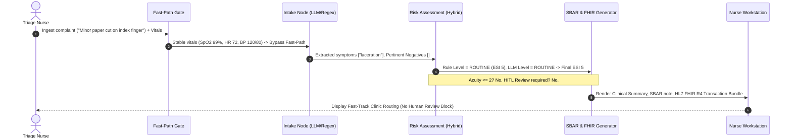
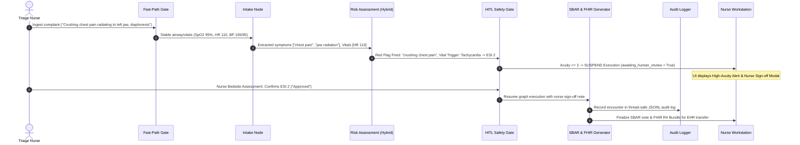

# System Architecture & Technical Specifications

**Smart Triage AI:** Production-grade Multi-Agent Decision-Support Copilot  
**Framework:** LangGraph `StateGraph` | **Standard:** Emergency Severity Index (ESI v4)  

---

## 1. Architectural Philosophy

The system replaces monolithic, open-ended agentic loops with a **constrained stateful DAG** combining generative intelligence with deterministic clinical guardrails:
1. **Deterministic Supervisor & Routing:** Graph routing is fixed by clinical workflow state. Routing is not where an LLM adds value; a deterministic supervisor eliminates nondeterminism, infinite loops, and unconstrained token cost.
2. **Hybrid Acuity with Safety Floor Invariant:** The LLM extracts semantic context and nuance, but the deterministic rule engine sets an inviolable floor:
   $$\text{Final Acuity} = \max(\text{Acuity}_{\text{LLM}}, \, \text{Acuity}_{\text{Rules}})$$
   The system can escalate acuity, but can never de-escalate below the rule-based red flag check.
3. **Resuscitation Short Circuit:** An $O(1)$ fast-path intercepts critical vital collapses ($\text{SpO}_2 < 90\%$, $\text{SBP} < 70$, $\text{HR} < 35$, comatose presentation) in \textbf{0.42 ms}, bypassing all LLM and graph latency.

---

## 2. End-to-End Execution Sequence Diagrams

### 2.1 Flow A: Low-Risk Presentation (Routine Flow)



### 2.2 Flow B: Emergent Presentation (HITL Suspended Flow)



---

## 3. Modular Directory Layout

```
agent/
  __init__.py
  schemas.py          # Pydantic models: RiskLevel, IntakeResult, RiskResult
  llm.py              # ChatGroq client factory with structured output & retry
  rules.py            # Deterministic red-flag safety floor & pediatric bounds
  multi_agent.py      # Core unified LangGraph StateGraph engine & fast-path
  audit_logger.py     # Thread-safe JSONL audit logger & concordance tracker
  sbar_generator.py   # Physician SBAR note & HL7 FHIR R4 bundle generator
  infermedica_client.py # Infermedica API v3 concept mapping client
  nodes/
    intake.py         # 3-tier clinical entity extraction
    risk.py           # Hybrid risk engine enforcing max_severity safety floor
    safety.py         # Output validator & safe communication generator
  memory/
    embeddings.py     # sentence-transformers all-MiniLM-L6-v2 (384d)
    store.py          # PatientMemory protocol, LocalMemory & PineconeMemory
```
